# 《All Code Is Slop》深度解析：如何让 Agent 写不出垃圾代码

## 来源信息

- 原文：https://guide.lukezystudio.cn/slop-trust/
- 讲者：Lauren Tan（`poteto`），SpaceXAI · Grok Bot 团队负责人
- 会议：AI Engineer CODE 2026，旧金山，2026-11-11
- 时长：17:31
- 视频：YouTube · O_zcc6Xl12g
- 整理原则：尽量保留原文排版、表格、代码块与演讲幻灯片图片

## 导读

SpaceX Grok Bot 团队用 10 月一个月 **10,926 个 PR**、**0.47% 回滚率**的成绩，回答了一个所有人都在问的问题：当 Agent 一天产出几百个 PR，人到底还怎么信任这份代码？她的答案不是「更好的 prompt」，而是**一套五层的信任环境工程**。

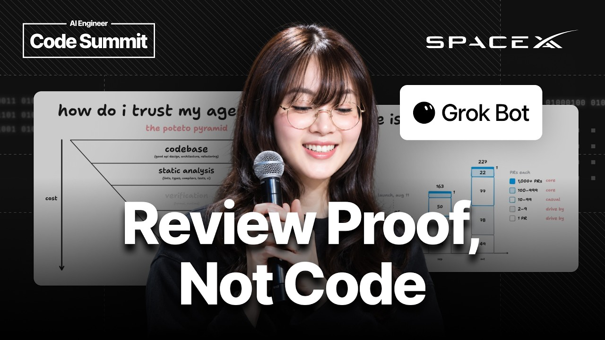

*官方视频封面：Review Proof, Not Code（审证据，不审代码）——这句话就是整场演讲的结论。*

## 01谁在讲，讲了什么

| 项目 | 内容 |
| --- | --- |
| 讲者 | Lauren Tan，网名 `poteto`（不是 potato），X 上签名 `@poteto` |
| 身份 | SpaceXAI 工程负责人，带 **Grok Bot** 团队；此前是 Cursor 核心工程师 |
| 会议 | AI Engineer **CODE** 2026，旧金山，11 月 11 日主会场 |
| 时长 | 17 分 31 秒（有双语字幕版） |
| 视频 | [YouTube · O_zcc6Xl12g](https://www.youtube.com/watch?v=O_zcc6Xl12g) |
| 幻灯片 | 手绘风格（她自己的插画），几乎每页只有一句话 |

先解释标题。标题是个反讽：**所有人都嫌别人用 AI 生成的代码是 slop（垃圾），但都默认自己写的不算。**
      「Slop」是 2024 年之后流行起来的词，专指 AI 大批量生产、看着像回事但质量低的内容。她的态度很干脆：不争论 slop 是谁造的，而是**把造 slop 这件事搞得足够贵、足够不方便**。

再看身份里的两条线索，它们解释了为什么这个人能讲这个题：

- **Cursor 时期**：她的反面案例（定时器泄漏、主进程／渲染进程互引、注释堆积）几乎全部来自 Cursor 编辑器的 Electron 代码库——都是真踩过的坑，不是理论。
- **Grok Bot 时期**：Grok Bot 是 xAI（与 SpaceX 合并后称 SpaceXAI）和 Cursor 合作的「AI 同事」产品，每个 Bot 有自己的云电脑，可以替你跨应用干活。它既是产品，也是她做自动化外循环的工具。

> **核心问题**
“Not blind trust, but investing in your agents' environment, so you can trust that your agents are going to do the right thing.”

不是盲目信任，而是投资 Agent 的**运行环境**，让你有理由相信它会做对的事。

这句话是整场演讲的题眼：信任不是一种态度，是一件可以被工程建设出来的东西。
      后面所有内容，都是「环境里到底该放什么」的排序问题。

## 02问题定义：一天 300 个 PR 的世界

演讲开场的数字对比，是理解一切的前提。她用两条曲线说明「审代码」这件事已经物理上不可能了。

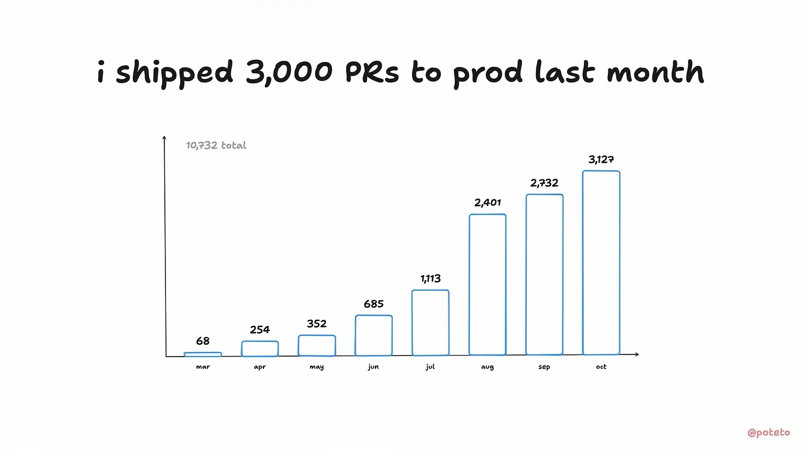

*“i shipped 3,000 PRs to prod last month”
          **她个人的月度 PR 数：**3 月 68 → 4 月 254 → 5 月 352 → 6 月 685 → 7 月 1,113 → 8 月 2,401 → 9 月 2,732 → 10 月 **3,127**。左上角的 10,732 是 8 个月总和。注意斜率：真正的拐点在 7→8 月，那是她说的「花了六个月打地基」之后。*

| 时间 | 个人 PR | 团队 PR | 团队累计 | 桌面端发版 | 回滚率 |
| --- | --- | --- | --- | --- | --- |
| 6 月 | 685 | 809 | 809 | — | 0.98% |
| 7 月 | 1,113 | 1,784 | 2,593 | — | — |
| 8 月 | 2,401 | 4,203 | 6,796 | 7 次 / 中位 44h | ≈0.48% |
| 9 月 | 2,732 | 5,648 | 12,444 | 19 次 / 中位 25h | ≈0.47% |
| 10 月 | 3,127 | **10,926** | **23,370** | 15 次 / 中位 28h | **0.47%** |

10,926 个 PR／月是什么概念？按 22 个工作日算是**每天约 500 个**。

2024 年的早上

#### 从「3 个」开始

- 到工位，审 3 个同事写的 PR
- 每个都能逐行读完
- 出问题可以口头问一句
- 「写得快」是极少数人的外号

现在

#### 变成「约 300 个」

- 要看约 300 个 PR 的产出
- 代码像水流，不是成批到达
- 每个工程师背后站着几百上千个 Agent
- 「任何人都能成为 coding machine」

这就把旧世界的默认值全部推翻了。旧世界的人之所以「信任」代码，靠的是双手审阅＋团队默契＋长期共事的直觉；300 个 PR／天意味着这三个支柱全部失效。于是只剩两条路：要么放弃信任（AI 写垃圾、人类擦屁股），要么改造环境让垃圾压根写不出来。

> **名词卡**
**PR**：Pull Request，一次提交给代码库的改动，通过评审和测试后合入。

        **Revert（回滚）**：改动合进去了，后来发现有问题，整个撤出。回滚率是「代码质量」最硬的指标之一。

        **Slop**：2024 年后流行，指 AI 批量生成的、看着像那么回事但质量低的内容。

        **AGENTS.md**：写给 Agent 读的项目说明文件（相当于给 AI 的 README）。

**关键推理**：0.47% 的回滚率意味着约**每 200 个 PR 才回滚 1 个**。这个数字之所以是全场最有力的证据，是因为它**与吞吐量反向**——按常识，PR 数量涨 13 倍，质量必然崩，回滚率该暴涨；实际却是从 0.98% 降到了 0.47%。

## 03核心模型：Poteto 倒金字塔

怎么把「审不过来」变成「不用审」？她画了一个**倒金字塔**，按「抓一个问题要花多少成本」给 Agent 环境的五层排了序。

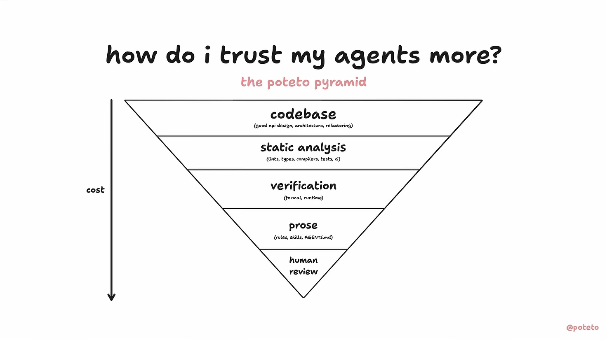

*“how do i trust my agents more? / the poteto pyramid”
          从上到下：**codebase**（good api design, architecture, refactoring）→ **static analysis**（lints, types, compilers, tests, ci）→ **verification**（formal, runtime）→ **prose**（rules, skills, AGENTS.md）→ **human review**。左边那根向下的箭头写的是 **cost**：越往下，每抓一个问题越贵。顶部最宽＝覆盖面最大＋单价最便宜。*

| 层 | 具体手段 | 拦截性质 | 单位成本 | 失败了会怎样 |
| --- | --- | --- | --- | --- |
| **① Codebase** | 好的 API 设计、架构边界、持续重构 | 让错误写法根本写不出来 | 一次性重构，之后永久免费 | 问题从「检查」变成「不存在」 |
| **② Static analysis** | Lint、类型系统、编译器、各类测试、CI | 确定性，写一次每次 commit 都跑 | 写规则一次，之后每次 commit 自动跑 | commit 直接失败，报错信息告诉 Agent 怎么改 |
| **③ Verification** | 运行时验证＋形式化验证（TLA+／Lean）＋属性测试 | 检查不变式，也检验 Agent 是否真懂你的意图 | 建模型＋解释结果，token 消耗大 | 录像只证明「走通的那条路」，模型检测走遍所有顺序 |
| **④ Prose** | Rules、Skills、`AGENTS.md` | 软约束，依赖 Agent 读懂并照做 | 每读一次都要「理解」，可能漏、可能过度外推 | 没人保证被遵守，所以「无可信之物」 |
| **⑤ Human review** | 人最后看一眼（最好只看验证产物） | 兜底 | 每次都要花一个人的时间 | 300 PR／天 → 必然走过场 |

### 为什么是「倒」金字塔

正金字塔的直觉是「底部基础最牢」，容易让人误以为要把力气花在写规则（prose）和人工 review 上。倒过来看才符合真实成本：

- 一条 lint 规则**写一次，之后每次 commit 免费跑**，结果永远一致；
- 一句写给 Agent 的话**每次都要被读、被理解、被正确执行**，而且会漂；
- 一次人工 review **每次都要花一个人的时间**，且随 PR 数线性增长。

所以：金字塔**顶部越宽，被便宜地拦下的问题就越多**，越到底部剩下的越少，人工 review 才可能退化成「看证据」。

### 最常见的错误：把金字塔用反了

她在演讲里没有点名，但现场能听出讽刺意味：很多团队一遇到 Agent 写歪，第一反应是**往系统提示词／AGENTS.md 里狂加规则**，最后指望人工 Code Review 兜底。

> **反模式**
上下文越塞越长 → Agent 照样犯错（甚至因为规则互相冲突而更糊涂）→ 于是再加规则 → 人类 review 变成瓶颈 → 最后得出结论「AI 写代码不靠谱」。而真正便宜且刚性的**代码库结构**和**静态分析**两层，一行都没做。

### 金句：纠正一次，落成一条检查

原话

“Whenever you're correcting your agent, think about how you can make that a deterministic check, instead of adding another line to your rules or your AGENTS.md.”

每次纠正 Agent 时，想一想怎么把它变成一条**确定性检查**，而不是往规则文件里再加一行。

她做了一个 8 次变更的对照实验，用来解释差异（配图说明用，数字是示意）：**同一个错误**（UI 代码直接 import 主进程代码），分别写成 AGENTS.md 一句话 vs 一条 lint 规则。

写成 AGENTS.md 的一句话

#### 6 次 OK

- 2 次**漏看**（没读到／skim 过）
- 1 次**过度外推**（把一句话当铁律乱用）
- 结果：错误写法进了代码库 **2 处**＋1 处误伤
- 全部靠人审查时才发现

写成一条 lint 规则

#### 6 次 OK

- 2 次**当场被拦**（commit 失败）
- 结果：错误写法进代码库 **0 处**
- 评审者从此不用再看这一项

这个对比里最值得学的是两个失败模式：

- **Miss（漏看）**：自然语言可能压根没被读到，或者被 skim 掉。
- **Over（过度外推）**：Agent 会把你随口一句小纠正当成「永不可破的铁律」，然后在完全不该用的地方执行它。她的原话是 Agent 会把它升级成 a hard rule “that can never be broken ever again”。

而 lint 规则**没法被「过度理解」**：它只覆盖写进去的那些模式，违反就当场失败，报错信息还能直接告诉 Agent 该往哪改。

## 04第 0 原理：Agent 是复制机

为什么「代码库」能排在金字塔最顶上？因为她给出了一个机理解释：

机理

**Agent 的输出取决于它的输入，而代码库是它最大的那个输入。**动手前，Agent 会翻代码看「这里通常是怎么做的」。所以你的 workaround、反模式、废弃代码、技术债，在下一个 Agent 眼里不是债，而是**既有规范**。

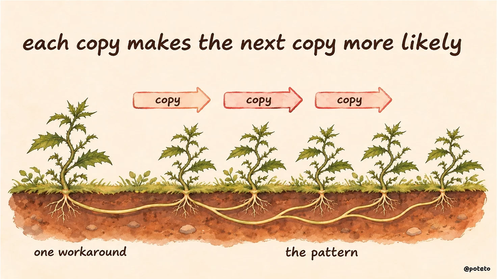

*“each copy makes the next copy more likely”
          一株杂草（one workaround）的地下根系会连成一片，久而久之整片草地都是它（the pattern）。她要说的不是「杂草会蔓延」，而是**每一次复制都让下一次复制更容易发生**——因为可被参照的样本变多了。*

这就是「复利」的反向版本。人类团队里，一个坏写法只要没人抄，就自然消亡；Agent 团队里，**每一个坏写法都在给自己投票**。她把这个过程总结成三层：

1. **第一层：低频反模式 → 高频模式。**仓库里出现 1 处临时绕过，下一个 Agent 就有 1 个样本可抄；出现 10 处，就变成「事实标准」。
2. **第二层：注释变成「授权书」。**写着「这里先这样，改动面太大」的注释，等于给下一个 Agent 发了许可证：*原来这个问题可以这样糊过去*。
3. **第三层：Markdown 文档泛滥。**Agent 特别喜欢生成没人要的说明文档，用来为自己「不修根因」做辩护。文档越多，越像「本项目允许这样做」。

所以她用的比喻是**打理花园**：约束和护栏是混凝土，新代码沿着它生长；杂草则相反，一株不拔，转眼满地。

可以立刻做的自查

在你的仓库里搜这几类「授权式注释」，它们是最高危的杂草种子：

        `// 临时`　`// TODO: 以后`　`// 先这样`　`// 改动面太大`　`// workaround`　`// 不知道为什么但删了就坏`

## 05第 1 层 Codebase：Dune 的三把抓手

Grok Bot 团队为 Electron 桌面端自建了一套应用框架 **Dune**（她类比为「Electron 界的 Next.js」）。她自己评价：「技术上没什么稀奇的」——真正有价值的是里面的**约束和 lint 规则**，那是他们做桌面应用踩坑后沉淀下来的东西。

### 抓手一：从分类上消灭「需要微妙技巧」的 API

> **判据**
“Anything that requires nuance to use well often leads to slop.”

任何「用好它需要微妙判断」的 API，最终都会产出垃圾。

经典案例就是 React 的 `useEffect`。官方文档说它是「让组件与外部系统保持同步」，不涉及外部系统时几乎不需要用；但实践中它极易被滥用，社区玩笑是「用好 useEffect 需要博士学位」。Agent 更差。

他们的做法简单粗暴且彻底：

- **业务代码禁止使用 `useEffect`**；
- 只允许它封装在 Dune 底层的少数几个 API 里；
- 于是**整类问题被「分类性消灭」**（categorically eliminated），Code Review 里永久少一项。

这条思路可以推广成一个设计工具：

| 症状 | 常规反应 | Dune 式反应（金字塔顶部） |
| --- | --- | --- |
| Hook 依赖数组老写错 | 写文档、加 review 项 | 禁掉裸 Hook，只留封装好的 API |
| 错误处理到处不一致 | 规定「必须 try/catch」 | 把返回值统一改成 `Result` 类型，让「忘记处理」编译不过 |
| 日期／金额格式五花八门 | 约定用某个工具函数 | 禁用原生 API，只暴露 `fmt.money()` |
| 并发调用竞态 | 提醒注意 | 提供唯一的 `useQuery` 封装，禁掉裸 fetch |

### 抓手二：目录结构本身就是上下文

这是全场我最推荐照抄的一条，成本极低、收益极高。

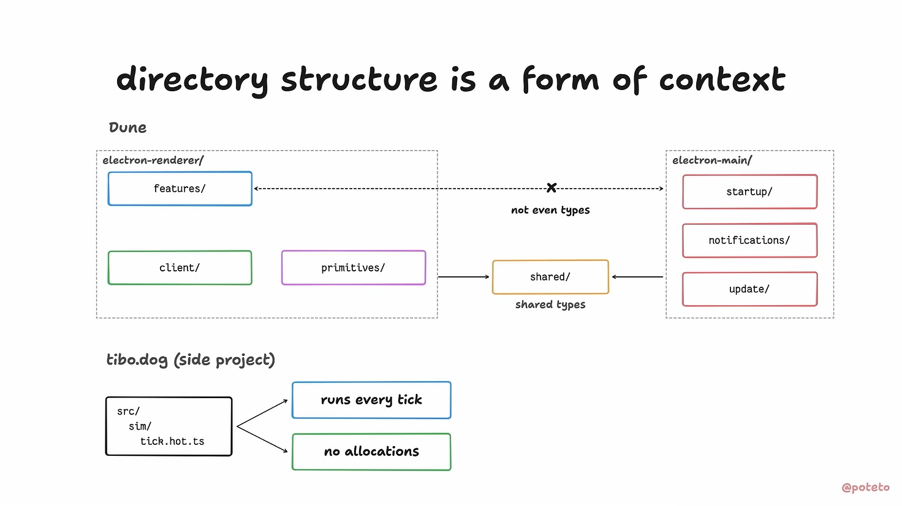

*“directory structure is a form of context”
          上半：Dune 只有两个顶层目录——`electron-renderer/`（含 `features/`、`client/`、`primitives/`）和 `electron-main/`（含 `startup/`、`notifications/`、`update/`）。两者之间的虚线被打了一个 **×**，标注 **“not even types”**：连类型定义都不许直接引用，必须统一走 `shared/`。

          下半：她的业余项目 tibo.dog，文件名 `src/sim/tick.hot.ts` 自带两条指令——**runs every tick**（每帧执行）和 **no allocations**（禁止内存分配）。*

为什么这条特别有效？因为 Cursor 时期踩过真坑：**Agent 经常把主进程代码导入渲染进程**，导致长任务阻塞 UI、界面卡顿。这类错误靠自然语言提醒根本管不住（「别这么写」它下次还写），但靠目录边界＋依赖图分析器就一次治死。

> **关键洞察**
**文件名、目录名、导入路径，全都是 Agent 能直接读到的「高优先级上下文」。**与其在 AGENTS.md 里写「性能关键路径不要分配内存」，不如把文件命名为 `tick.hot.ts`——前者需要 Agent 读到并联系起来，后者在它 ls 目录、敲 import 的时候就已经看到了。

### 抓手三：注释是负债，不是资产

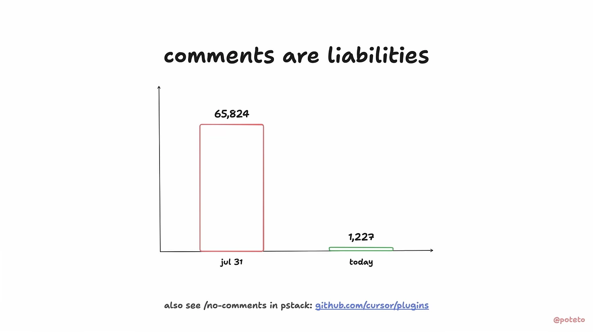

*“comments are liabilities”
          **7 月 31 日：65,824 条**；**今天：1,227 条**。删掉约 99%。页脚还写着 *also see /no-comments in pstack*，指向她开源的清理技能。*

这个数字第一次看会觉得过激，但她的推理链很硬：

1. **注释是不可执行的。**「我要告诉下一个 Agent 别这么做」听起来善意，但没有任何东西保证它被遵守，所以**没有可信任之物**。
2. **注释会过期。**代码改了，注释不变，于是注释从「解释」变成「误导」。
3. **注释会被当作辩护词。**Agent 写注释时常常是在解释「我为什么没修根因」，这类注释直接授权下一个 Agent 抄同款偷懒。

替代方案就是她反复强调的：**规则写进 lint 的报错信息里**，而不是写进注释里。报错信息是「可执行的 prose」——它在你违规的**那一刻**出现，并指出修复方向。

### 事故复盘：183 个定时器

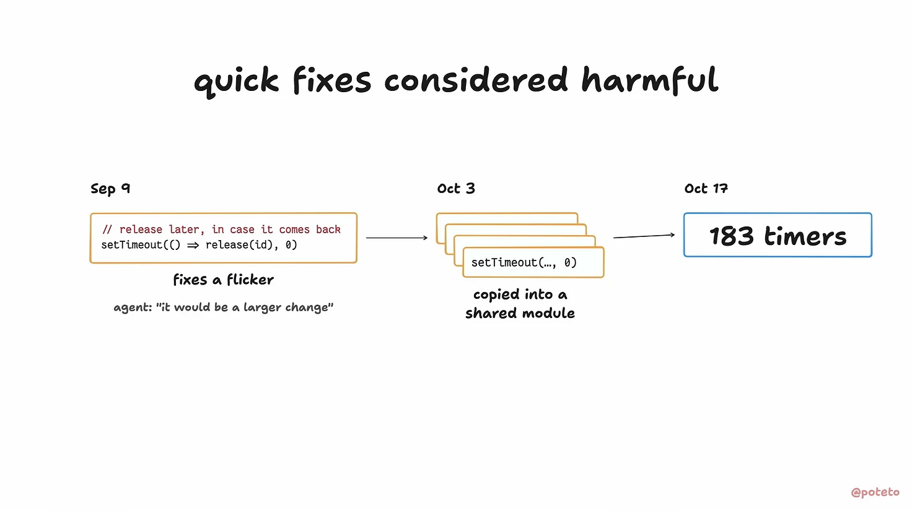

*“quick fixes considered harmful”
          **9 月 9 日**：某 Agent 为修一个界面闪烁，写了 `setTimeout(() => release(id), 0)`，上方注释 “release later, in case it comes back”，理由是 *“it would be a larger change”*（彻底改涉及面太大）。

          **10 月 3 日**：另一个 Agent 觉得这写法不错，**复制进了公共模块**。

          **10 月 17 日**：仓库里长出 **183 个定时器**，频繁创建／销毁触发严重 GC 卡顿。*

这条时间线值得逐段拆，因为它把「复利」具象成了三个阶段：

| 阶段 | 发生了什么 | 为什么当时「合理」 | 真正的错在哪 |
| --- | --- | --- | --- |
| **播种** 9/9 | 用 `setTimeout(..., 0)` 延迟释放，绕过竞态 | 它确实修好了闪烁；而且「彻底改动涉及面太大」是真实约束 | 没修根因，还用注释把妥协**合理化了** |
| **扩散** 10/3 | 被复制进公共模块 | 公共模块里出现一个「已验证可行」的写法，是最强信号 | 公共模块放大了它的「权威性」 |
| **爆发** 10/17 | 183 个定时器，GC 卡顿 | —— | 单点每次只「贵一点」，聚合后才变成性能事故 |

教训

这类问题**不会以「错误」的形式出现，而是以「性能缓慢下降」的形式出现**，所以很难归因。对付它的唯一办法是把「临时妥协」变成机器能拦住的东西——例如一条禁止裸 `setTimeout` 的 lint，或一个只暴露 `scheduleMicrotask` 的统一封装。

### 小结：三层抓手对照表

| 抓手 | 要治的病 | 手段 | 你项目里的对应做法 |
| --- | --- | --- | --- |
| 消灭 nuance API | 难用对的 API 必然被用错 | 禁掉它，只留安全封装 | 禁用裸 fetch／moment／原生 alert，统一封装 |
| 目录即上下文 | 跨层乱引、职责混淆 | 顶层强隔离＋依赖图分析 | 按 layer 分目录，加 import 边界检查 |
| 注释是负债 | 过期／辩护型注释被当规范 | 删注释，规则进 lint | 只留「为什么」和业务不变式，删「怎么办」和「先这样」 |

## 06第 2 层 Static analysis：7 → 167 条规则

如果只有一句话能带走，就是这句：**每纠正一次 Agent，就补一条带清晰修复指引的 lint 或架构约束。**

她展示了一条 7 月 1 日 → 11 月 1 日的阶梯曲线，规则数量是这样长起来的：

| 时间点 | 累计规则数 | 增量 | 解读 |
| --- | --- | --- | --- |
| 7 月初 | 7 | — | 起点：手写时代留下的几条 |
| 7 月中 | 17 | +10 | 开始「见错就落规则」 |
| 8 月初 | 38 | +21 | Agent 吞吐上来，纠错频率变高 |
| 8 月底 | 90 | +52 | **最陡的一段**，与 PR 暴涨同步 |
| 9 月中 | 139 | +49 | 开始覆盖边界与特例 |
| 10 月初 | 149 | +10 | 进入长尾 |
| 10 月中 | 157 | +8 | — |
| 11 月初 | **167** | +10 | 规则库趋于稳定 |

请注意这条曲线的形状：**先陡后平**。这不是「堆规则堆到满分」，而是典型的**长尾收敛**——前 90 条捞掉了 90% 的重复错误，之后每一轮纠错只产出个位数新规则。当规则不再增长时，意味着这一类错误基本绝迹了。这正是她后面敢做自动合并的前提。

### 一条好 lint 应该长什么样

她说得很明确：规则要带**清晰的修复指引**，而且要引导 Agent **修根因而不是打补丁**（fix the root cause rather than patch around it）。所以报错信息的写法比规则本身更重要：

```
// 只报错，Agent 会去「绕过它」
error: 'useEffect' is restricted (no-restricted-syntax)

// 给出原因 + 替代路径 + 根因方向，Agent 会去「修对」
error: 'useEffect' is not allowed in product code  [dune/no-useeffect]
  Why: effect-based code is hard for agents to reason about correctly,
       and has repeatedly produced data races and stale closures.
  Fix: use `useExternalStore` (sync with external system) or
       `useDerivedState` (computed value) from @dune/react.
  Do NOT: wrap it in a custom hook to work around this rule —
          move the logic into a Dune primitive instead.
```

这个模板可以抽象成三行，任何团队都能直接套：

1. **Why（为什么禁）**：一句人话解释这类写法的危害，让 Agent 理解意图，而不是死记规则。
2. **Fix（怎么改）**：给出**具体的 API 名**，不要只说「用更好的方式」。
3. **Do NOT（别绕过）**：明确禁止「包装一层绕过检查」这种最典型的 Agent 行为。

### 为什么这一层是「确定性」的

她在演讲里反复用 “deterministic” 这个词。对比一下就明白：

| 性质 | Prose（AGENTS.md／对话） | Static analysis（lint／类型／CI） |
| --- | --- | --- |
| 是否每次都执行 | 取决于 Agent 是否读到、是否理解 | **每次 commit 必然执行** |
| 结果一致性 | 随上下文、模型版本、心情漂移 | 同一输入永远同一输出 |
| 能否过度外推 | 会（一次小纠错 → 铁律） | 不会（只覆盖写进去的模式） |
| 维护成本 | 越堆越长，互相冲突 | 每条独立，可删可改 |
| 对人类的可审计性 | 无法证明被遵守 | 可以在 CI 里看到通过／失败 |

> **可操作的判据**
下次你被 Agent 气到，先问一句：**这个错误，能不能用一条机器检查拦住？**

        能 → 写 lint／类型／测试。不能 → 再问：**能不能用架构把它变成「写不出来」？** 还是不能 → 才写进 prose。

## 07第 3 层 Verification：从「我跑通了」到「所有路径都成立」

当代码库和静态检查把便宜的活干完了，剩下的问题变成：**Agent 到底有没有实现你的意图？**这一层是为回答这个问题而存在的，也是她把 Code Review 从「读代码」改造成「审证据」的关键。

### 7.1 运行时验证：让 Agent 自己跑一遍

最基础的形式是：给 Agent 一套能自己运行程序、并用人类同款调试工具（比如 **Chrome DevTools Protocol**）观察它的手段。他们做了两件非常工程化的事：

Feature Map

#### 功能地图

- 像网站地图，但描述的是**用户视角**的功能：应用里有哪些功能、用户怎么点过去、什么状态算跑通
- 解决了「左边栏那个小按钮叫什么」的沟通问题
- 本质是**共享词汇表**：把模糊指代变成可定位坐标

Custom CLI

#### 自定义命令行

- 把 CDP 等调试动作包成可复用命令行
- 省 token（不用每次生成一大段脚本）
- CLI 本身**可被单独测试**，是一等公民
- Agent 每次用同一个驱动，行为可复现

```
$ app aria-click --accessible-name "Settings"
$ app snapshot              # 导出当前界面结构（给 Agent 读）
$ app screenshot proof.png  # 生成可贴进 PR 的证据
```

注意最后一行：`screenshot proof.png`。**这不只是调试工具，它是「证据生产工具」。**人类评审时看到的是这张图／这段录屏，而不是 diff。

### 7.2 一个致命的局限：一次录像只证明一条路

> **关键洞察**
**A recording walks only one path.** 录屏只证明 Agent 走过的那条路径是好的。如果存在别的执行顺序会让系统坏掉，录屏永远发现不了。

这个局限直接推出了他们为什么要用形式化验证。她给了一个极好的例子：**跨设备通知**。

规则（不变式）是：**一条消息在任何设备上被读过之后，同步完成后，其他设备都不该再显示它未读。**

四条事件：① 手机收到 → ② 笔记本收到 → ③ 在手机上读 → ④「已读」同步到笔记本。四种可能顺序，结果完全不同：

| 顺序 | 会发生什么 | 笔记本最终状态 |
| --- | --- | --- |
| ①→②→③→④ | 最顺的路径：消息都到了，然后读，然后同步 | 已读 ✓ |
| ②→①→③→④ | 笔记本先到，无影响 | 已读 ✓ |
| ①→③→②→④ | 手机上先读，然后笔记本才收到消息，再同步 | 已读 ✓ |
| ①→③→④→② | **「已读」比消息先到笔记本**；消息随后到达时被当成新消息 | 卡在未读 ✗ |

手动测试和录屏几乎永远走第一条路（最顺的那条），所以这个 bug 能活很久。**模型检测会把四种顺序全走一遍，第四种当场暴露。**

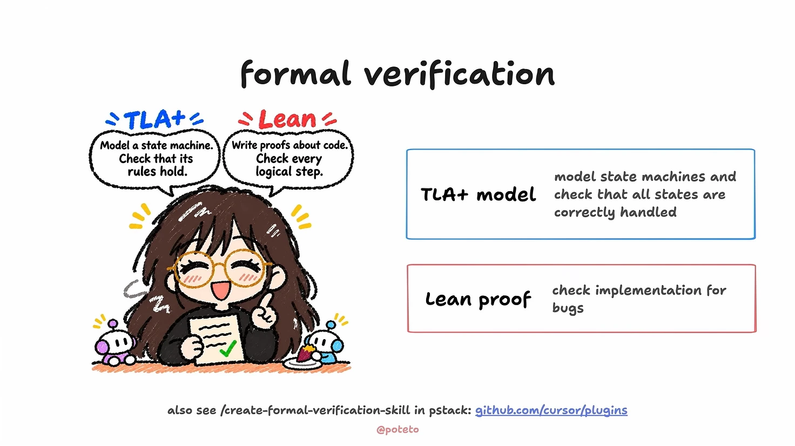

*“formal verification”
          左侧对话框：**TLA+** ＝ “Model a state machine. Check that its rules hold.”；**Lean** ＝ “Write proofs about code. Check every logical step.”

          右侧卡片：TLA+ model —— 对状态机建模，检查**所有状态**都被正确处理；Lean proof —— 检查实现是否有 bug。*

### 7.3 两件形式化武器分别用来干什么

| 工具 | 本质 | 她的用法 | 适合什么问题 |
| --- | --- | --- | --- |
| **TLA+** | 把流程写成状态模型，让机器穷举事件顺序，检查规则是否永远成立 | 主用户流程：跨设备、多平台的通知同步 | 并发／分布式／多端同步／状态机类——顺序敏感的逻辑 |
| **Lean** | 为算法写数学证明，机器逐步检查推理 | 自研的虚拟化滚动库（聊天记录上万条只画可见的十几条），证明它**不会闪烁或抖动** | 算法正确性／数值边界／性能敏感且难以用测试覆盖的组件 |
| **Bombadil** | 开源 UI 属性测试（Antithesis），自动在界面里随机乱点，检查指定属性是否被破坏 | 刚起步，已经抓到几个 UI bug | UI 交互边界——人手想不到的点击组合 |

她对形式化的态度非常克制，这点很重要：

> **她的原话（意译）**
这套方法**还在实验阶段**，看起来很有希望，已经抓到不少 bug，但它**绝对不是银弹**——只是 Agent 环境里的又一层。

### 7.4 /statechart：让 Agent 证明它懂你

形式化还有第二个用途，这个用途更容易被忽略：**帮你把产品想清楚，并检验 Agent 是否真的理解了你的意图。**

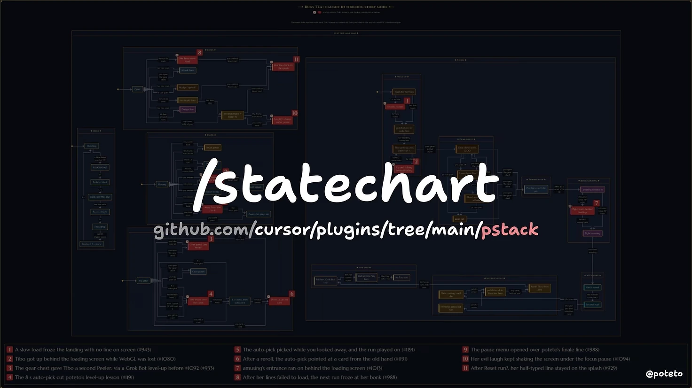

*“Bugs TLA+ caught in tibo.dog story mode”
          她用 `/statechart` 技能从用户视角画出状态机：用户可能处于哪些状态、什么操作导致什么迁移。红色格子是 TLA+ 发现规则被破坏的状态，底部列出 11 个，例如「慢加载让落地页冻住且屏幕上没有线（#943）」、「暂停菜单盖在 poteto 的结局台词上（#988）」。

          **这张图配合录屏和截图一起看，比读代码容易得多。***

### 7.5 五类验证的分工表

她明确区分了两类验证：**有的帮机器找错，有的帮人审查**。混淆这两件事是很多团队的误区。

| 验证方式 | 做什么 | 属性 | 例子 |
| --- | --- | --- | --- |
| 运行时验证 | Agent 打开应用，按 Feature Map 找功能，点一遍 | **找错**＋**供审**（交回录像和截图） | 点设置页，截图 |
| `/statechart` | 把用户可见的状态与迁移画成一张图 | **供审**（检查 Agent 是否理解了流程） | 故事模式的 11 个状态 |
| TLA+ 模型检测 | 把流程写成状态模型，穷举所有顺序 | **找错** | 跨设备通知 |
| Lean 证明 | 逐步证明算法，机器检查每一步 | **找错** | 虚拟滚动不抖动 |
| Bombadil 属性测试 | 自动在界面里随机探索，验证属性恒成立 | **找错** | UI 边界 bug |

### 7.6 为什么「昂贵的老技术」今天才用得起

这一节是整场演讲里最具时代感的部分。她引了 Cindy Sridharan（`@copyconstruct`）的两条推文，隔了半年：

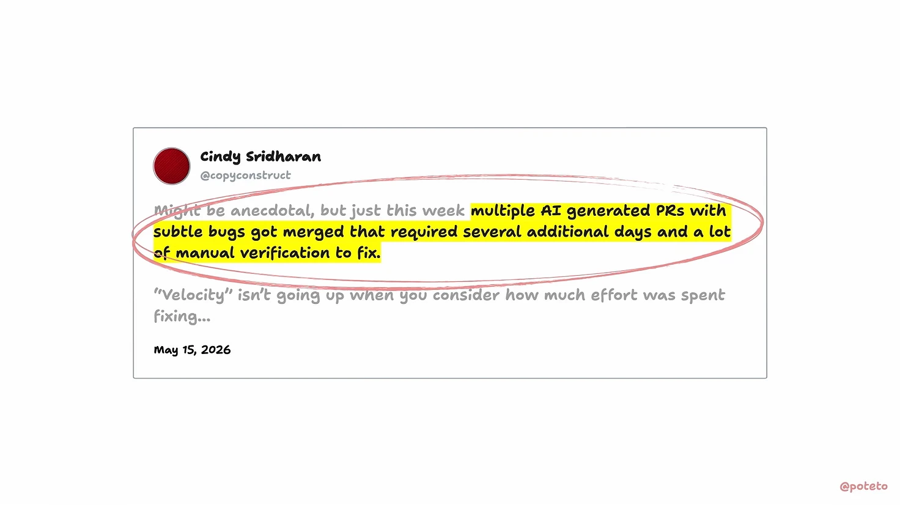

*Cindy Sridharan, 2026-05-15
          “Might be anecdotal, but just this week **multiple AI generated PRs with subtle bugs got merged** that required several additional days and a lot of manual verification to fix.”

          “「速度提升」这个说法站不住脚——你算进修 bug 花掉的力气了吗……”*

半年后（2026 年 11 月）同一个人改口了：**每天 70% 的 token 花在验证补丁上，只有 20–30% 花在生成代码上**，此后再没遇到过半年前那种翻车。Lauren 说她自己也是这样，绝大部分 token 花在验证上。

> **真正的论点**
**Cindy 流程里没有一个新工具。**TLA+（1999）、Lean、属性测试、模型检测——全都是老技术。它们过去贵，不是因为难写对，而是因为**「写模型、写证明、维护测试」这件事本身要大量人力**。Agent 把这部分人力成本砍掉了，于是这些技术第一次在经济上划得来。

她的结论：**我们正在进入软件测试与验证的黄金时代**——以前「不值得测」的东西，现在可以测得比过去彻底得多。

但请注意一个重要的**秩序不变**：金字塔的顺序没变。能被代码库和静态检查拦下的错误，**仍然先在那里拦**。形式化是补充，不是替代。

## 08收益面板：11,000 PR 与 0.47% 回滚率

### 8.1 不是「少数超人变快」，是「全员变快」

这里有个很容易被忽略的细节：如果只有 1 个人 PR 暴涨，那说明是个人英雄主义；她证明的是**分布整体右移**。

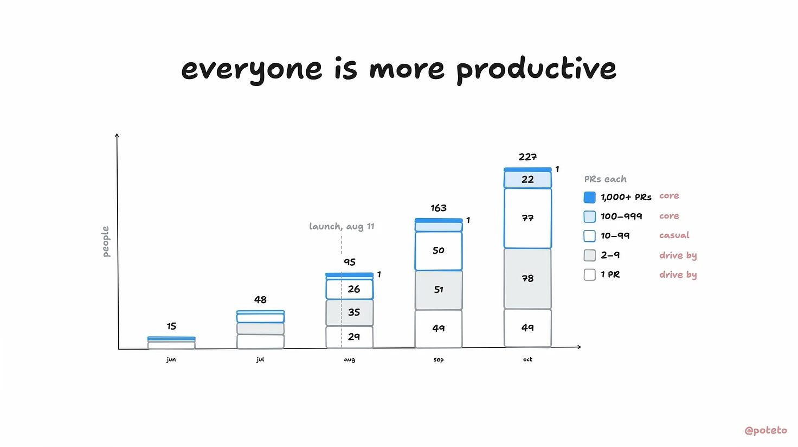

*“everyone is more productive”
          每根柱子是当月**提交过至少一个 PR 的人数**：6 月 15 → 7 月 48 → 8 月 95 → 9 月 163 → 10 月 **227**（8 月 11 日标注 launch）。柱子按「每人提交多少个 PR」分层，右图例：**1000+ 为 core**、**100–999 为 core**、**10–99 为 casual**、**2–9 / 1 个为 drive by**。*

10 月的分层拆解（这五项加起来正好 227）：

| 每人 PR 数 | 人数 | 类型 | 含义 |
| --- | --- | --- | --- |
| 1000+ | 1 | core | 一个人撑起 4 位数 |
| 100–999 | 22 | core | 重度使用者，8 月还只有约 4 人 |
| 10–99 | 77 | casual | **增长最快的一层**，8 月 26 人 |
| 2–9 | 78 | drive by | 顺手贡献 |
| 1 | 49 | drive by | 只提了一个 PR，8 月 29 人 |
| **合计** | **227** | — | 8 月 95 → 9 月 163 → 10 月 227 |

读法很重要：**增长最快的是「10–99 个 PR」这一层（26 → 77）**，而不是顶层的 1 个人。这意味着工具和环境真的让「普通工程师」变成了高产者，而不是造出了几个怪物。同时 **drive-by 贡献者从 29 → 49** 说明外部人也能安全地往里塞代码——这恰恰依赖前面那些约束。

### 8.2 性能：连变差的指标也一起放出来

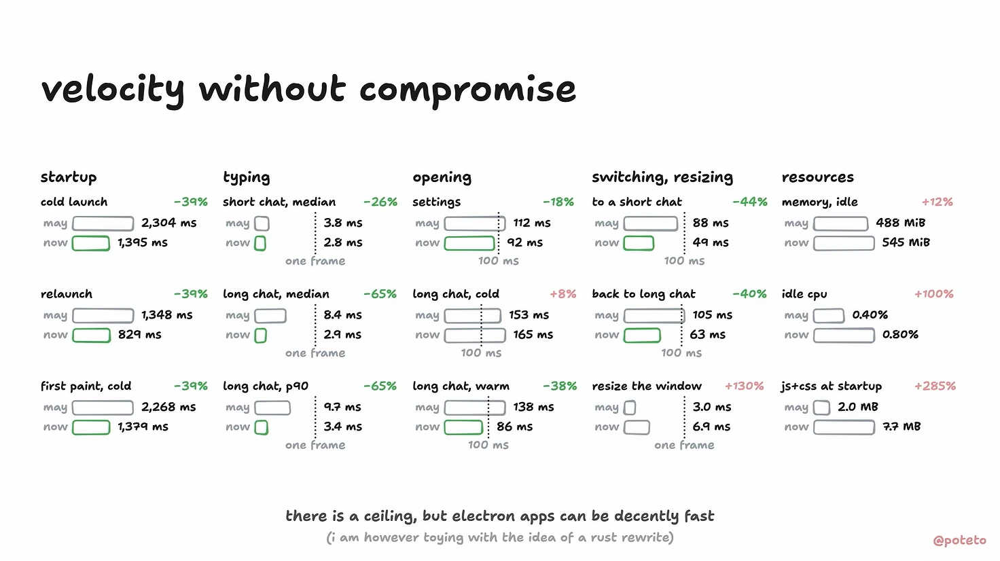

*“velocity without compromise”
          5 列 15 项指标，绿色是变快，红色是变慢／变重。页脚写着：**“there is a ceiling, but electron apps can be decently fast”**——并补了一句她在考虑用 Rust 重写。*

| 类别 | 指标 | 5 月 | 现在 | 变化 |
| --- | --- | --- | --- | --- |
| 启动 | 冷启动 cold launch | 2,304 ms | 1,395 ms | −39% |
| 重启 relaunch | 1,348 ms | 829 ms | −39% |
| 首次绘制（冷） | 2,268 ms | 1,379 ms | −39% |
| 输入响应 | 短对话打字（中位） | 3.8 ms | 2.8 ms | −26% |
| 长对话打字（中位） | 8.4 ms | 2.9 ms | −65% |
| 长对话打字（P90） | 9.7 ms | 3.4 ms | −65% |
| 打开 | 设置页 | 112 ms | 92 ms | −18% |
| 长对话冷开 | 153 ms | 165 ms | +8% |
| 长对话热开 | 138 ms | 86 ms | −38% |
| 切换／缩放 | 切到短对话 | 88 ms | 49 ms | −44% |
| 切回长对话 | 105 ms | 63 ms | −40% |
| **调整窗口大小** | 3.0 ms | 6.9 ms | +130% |
| 资源 | 空闲内存 | 488 MiB | 545 MiB | +12% |
| **空闲 CPU** | 0.40% | 0.80% | +100% |
| **启动加载 JS+CSS** | 2.0 MB | 7.7 MB | +285% |

> **这个面板为什么值得学**
她自己把三项变差的指标（窗口缩放 +130%、空闲 CPU +100%、启动包体 +285%）**原样放在幻灯片上**。这比「我们一切都变好了」有说服力得多——因为它说明这套指标是**真的在测**，而不是挑好看的报。

顺带一提，这三项变差本身也在讲故事：功能多了 7.7MB 包体、渲染成本上升。「不妥协」不等于「没有代价」，而是**代价被看见了**。

## 09外循环：不要自动化一个坏循环

地基铺好之后，自动化就变得简单了。但在讲自动化之前，她先讲了一个警告。

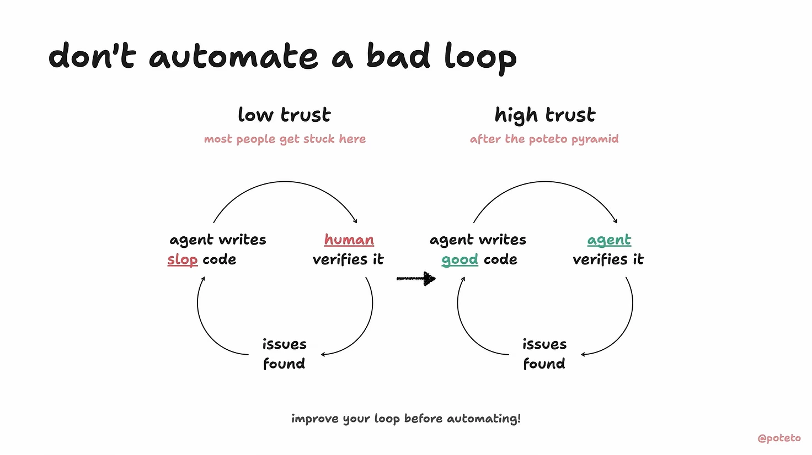

*“don't automate a bad loop / improve your loop before automating!”
          **左：低信任**（most people get stuck here）——Agent 写 slop 代码 → 人验证 → 发现问题 → 打回。

          **右：高信任**（after the poteto pyramid）——Agent 写好代码 → **Agent 自己验证** → 发现问题 → 自己修。*

> **警告**
“If your inner coding loop produces slop, then automating that loop just produces more slop.”

如果内循环产的是垃圾，自动化它只会产出更多垃圾——而且你得往里砸**越来越贵的 token**。

### 她自己的顺序（三阶段）

1. **修内循环。**每次纠正 Agent，就先写一条 lint 防住新的，再清掉旧的同类；然后确保验证能力真的够强。
2. **让 Agent 自己验证。**Feature Map＋CLI＋状态机图＋形式化，把「人验证」换成「Agent 验证，人看证据」。
3. **才接外循环。**把定时触发、监控告警、连接器接上，让工厂自己转。

她强调前两步本身就是自动化的**前置条件**：如果验证不可信，自动合并就是将错误直接送进主干。

### 真实的外循环案例：每次发版自动 fuzz

她的外循环用的就是 Grok Bot 自己：它有丰富的连接器、能拉起 Cursor 云 Agent 的 routine、以及可以编排成百上千 Agent 协同的 project。以发版流程为例：

1. **切新版本**——桌面端大约每天一个稳定版。
2. **Grok Bot 自动起一个 Cursor project**——无人触发，是一批 Cursor 云 Agent。
3. **像真实用户一样用整个构建**——fuzz：跑起来，试各种操作，记录每个 bug。
4. **每个 bug 开一个修复 PR**——发现多少开多少。
5. **自动合并**——因为代码库已经好到「PR 默认就是好的」。

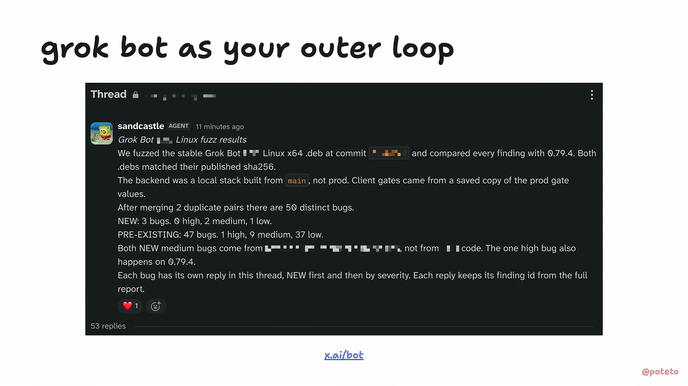

*“grok bot as your outer loop”
          一个叫 **sandcastle** 的 Agent 在 thread 里贴出的 Linux fuzz 报告（部分内容被涂黑）：对稳定版 Linux x64 `.deb` 做 fuzz，把每个发现与 0.79.4 对比，两个 .deb 的 sha256 都与发布值一致。合并 2 对重复后共 **50 个去重 bug**：**NEW 3 个**（0 高／2 中／1 低）；**PRE-EXISTING 47 个**（1 高／9 中／37 低）。那两个新中危来自被涂黑的部分（不是 Cursor 代码）；唯一的「高」在 0.79.4 上也存在。每个 bug 在 thread 里有独立回复，NEW 优先再按严重度，共 **53 条回复**。*

这段报告的信息密度很高，值得逐条读：

- **它做了 baseline 对比**（0.79.4），把「新引入」和「历史遗留」分开——这是工程成熟度的标志。
- **它做了去重**（2 对重复合并），不是刷数量。
- **它给了严重度分级**，而不是笼统说「发现 50 个问题」。
- **输出结构化到 thread 里**，人和 Agent 都能继续跟进。

> **关键前提**
她敢开自动合并，理由只有一句：**代码库已经足够好，PR 默认就是好的**（“most product code that we land no longer really requires deep human review”）。

换句话说，**自动合并不是「信任」换来的，是「约束」换来的**。有扎实的地基和良好的有机架构，才能「把 slop 变成金子」。

## 10这套方法的局限：演讲没回答的三件事

一份好的学习笔记不能只有宣讲。以下三个问题在看完演讲后立刻会浮现，而演讲只回答了一部分。

| 问题 | 演讲给了什么 | 缺口 |
| --- | --- | --- |
| **① 哪些改动可以自动合并，哪些必须人看？** | 只说「大部分产品代码不再需要深度人工评审」，发版后发现的 bug 修复会自动合并 | 没有给出「仍需人看」的类别清单。实践中这恰恰是最难定的边界（涉及支付、隐私、数据迁移、鉴权） |
| **② Agent 写代码、Agent 验证，那谁验证验证？** | 人说「审查验证产物」：录像、截图、状态机图 | 当验证本身漏了某条路径、或用错了基线（baseline）时会发生什么，没讨论 |
| **③ 除了回滚率，线上质量如何？** | 只有回滚率和性能数据；fuzz 报告侧面说明那次构建有 3 个新 bug 且无高危 | 没有其他生产事故数据（P0／P1 次数、MTTR、用户可见故障率） |

> **数据性质声明**
所有数字（PR 数、回滚率、贡献者数、性能）**都是团队自报**。而且 PR 本身大小差异极大（一个改错别字的 PR 和一个重构的 PR 都算 1 个），所以这些数字**不能直接换算成生产力倍数**。它们能证明的是「顺序和方向」，不能证明「精确倍率」。

### 两条我建议的「水土不服」修正

把她的做法搬到自己团队时，有两个地方不能照抄：

| 她的做法 | 成立的前提 | 你应该怎么改 |
| --- | --- | --- |
| 注释从 65,824 删到 1,227（−99%） | 目录结构、类型系统、API 命名本身足够清晰，代码「自解释」 | 老项目里到处是黑盒逻辑和隐式状态机，一刀切删注释会让人类和 Agent **一起抓瞎**。先禁止「解释为什么偷懒」的过程注释，保留业务不变式与「为什么」的说明。 |
| TLA+／Lean 全流程上用 | Agent 大幅降低了建模成本，而且团队有对应技能 | 建模与解释仍消耗大量 token（参考 Cindy 的 70% 验证开销）。**只对高价值核心链路用**（多端同步、资金、权限）；中小团队先把 lint＋依赖边界＋CLI 截图自检跑起来，性价比高得多。 |

> **一句话总结局限**
这场演讲是一份**极其扎实的「如何建立约束」的工程报告**，但它不是「如何保证正确」的证明。它回答的是「怎么让 Agent 少犯错」，而不是「怎么保证 Agent 不犯错」——这两者的差距，恰好就是人工评审仍然必须存在的理由。

## 11落地路线图：从你自己的代码库开始

她说自己花了六个月才到这，但「你会比我快得多」。下面按她的金字塔顺序排了一份可执行路线，每一步都带验收标准。

### 阶段 0 · 第 1 周：先看清自己卡在哪一层

| # | 动作 | 验收标准 |
| --- | --- | --- |
| 0.1 | 翻出最近两周被人工打回的 10 个 Agent PR | 列出重复出现的问题模式（跨模块导入、滥用副作用 Hook、硬编码兜底…） |
| 0.2 | 给每个模式标注「能写成什么检查」 | 每条都落到 lint／类型／目录边界／测试 之一，实在不行才标 prose |
| 0.3 | 统计仓库里的「辩护型注释」与垃圾 Markdown | 得到两个数字：可疑注释条数、Agent 生成的无关文档数 |
| 0.4 | 量一次基线：回滚率、CI 通过率、平均 PR 存活时间 | 有数，哪怕很粗。没有基线后面无法证明改进 |

### 阶段 1 · 第 2–4 周：把前 20 条检查立起来

| # | 动作 | 验收标准 |
| --- | --- | --- |
| 1.1 | 把 0.2 里成本最低的 10 条做成 lint 规则，每条带 Why／Fix／Do NOT 三段说明 | 新提交触发时能给出可操作的修复指引 |
| 1.2 | 给仓库加「依赖边界检查」（分层目录＋import 白名单） | 跨层引用当场失败，连类型也不许绕过 |
| 1.3 | 清理辩护型注释；把真正的规则搬进 lint | 搜不到「先这样／改动面太大／临时」类注释 |
| 1.4 | 建立「纠正即落规则」的习惯（写进团队约定） | 每次 review 打回，PR 里必须附一条新规则或说明「为什么不能自动化」 |

### 阶段 2 · 第 2 月：让 Agent 能自己验证

| # | 动作 | 验收标准 |
| --- | --- | --- |
| 2.1 | 写最小 Feature Map：用户视角的功能树＋怎么走到＋什么算跑通 | 说「侧边栏那个按钮」时，Agent 能定位到具体功能 |
| 2.2 | 把调试动作包成 CLI（点击／截图／快照） | Agent 能一条命令产出可贴进 PR 的截图 |
| 2.3 | 改评审规则：先看录像与截图，再决定要不要翻 diff | 评审平均耗时下降，且没有回滚率上升 |
| 2.4 | 对 1 个状态机复杂的功能画 `/statechart` | 能用一张图讲清「用户可能处于哪些状态」 |

### 阶段 3 · 第 3 月：挑一条链路做形式化，再试外循环

| # | 动作 | 验收标准 |
| --- | --- | --- |
| 3.1 | 选 1 个「顺序敏感」的核心流程（多端同步／并发状态）做 TLA+ 建模 | 能被穷举出至少 1 个「录屏永远测不到」的顺序 bug |
| 3.2 | 对 1 个最难测的算法／组件写 Lean 证明（可选） | 证明能通过，且能讲清它保证了什么 |
| 3.3 | 引入 UI 属性测试（如 Bombadil）在 CI 里随机探索 | 能稳定抓到至少一个交互边界 bug |
| 3.4 | 只在**确定低风险**的类别（如文档、测试、发版后修复）试自动合并 | 回滚率不上升。上升就退回阶段 1 |

### 三步紧急自查（如果只想做一件事）

1. **翻 10 个被打回的 PR**，找出能写成 lint 的重复问题。先写进工具，**最后**才写进 AGENTS.md。
2. **清掉「辩护型注释」和垃圾 Markdown**。这类注释在 AI 时代就是下一个 Agent 照抄反模式的授权书。
3. **给核心页面补 Feature Map＋截图命令**。让 Agent 改完 UI 自己点一遍、截图贴回 PR；人先看视频再决定要不要翻 diff。

## 12习题：十二道自测

分三组：A 概念理解（看懂了吗）、B 实操推演（会做吗）、C 设计题（能迁移吗）。建议先自己想 30 秒再展开答案。

### A 组 · 概念理解

<details>
<summary>A1为什么金字塔是「倒」的？如果把 cost 箭头理解成「成本」，顶部最宽意味着什么？</summary>

**要点：**

- 「成本」指**抓一个问题所付出的单价**：lint 写一次永久跑（≈0），一句话 prose 每次都要被读懂（中），人 review 每次花一个人的时间（高）。
- 倒金字塔顶部最宽 ＝ **覆盖面最大＋单价最低**。所以问题应该尽量在顶部被拦下，越往下剩得越少。
- 推论：人力应该优先投入「让顶部变宽」，而不是「把底部加固」（加规则、加 review 人数）。

</details>

<details>
<summary>A2她说「注释是负债」，请给出三条独立的理由，并说明什么注释是应该保留的。</summary>

**三条理由：**

- **不可执行**：说「别这么做」没有任何机制保证被遵守，所以没有可信任之物。
- **会过期**：代码变了注释没变，从「解释」退化成「误导」。
- **会被当辩护词**：Agent 用注释解释「我为什么没修根因」，等于授权下一个 Agent 抄同款偷懒。

**应该保留的：**业务不变式（「金额单位是分，不是元」）、非显然的「为什么」（「这里必须用 string 比较，后端返回的 ID 超出 JS 安全整数」）、外部约束来源（「API 限制 QPS＝5，见工单 #123」）。

**应该删的：**复述代码在干什么的注释、「临时／先这样／改动面太大」类注释、只用来说明本次改动的注释（那属于 PR 描述）。

</details>

<details>
<summary>A3183 个定时器这个事故里，「当时看起来合理」的三个环节分别是什么？为什么这类问题特别难发现？</summary>

**三个环节：**

- **播种**（9/9）：它确实修好了闪烁，且「彻底改动涉及面太大」是真实约束 → 妥协合理，但被注释合法化了。
- **扩散**（10/3）：被复制进**公共模块**，公共模块里出现的写法会被当成「已验证的团队做法」，权威性被放大。
- **爆发**（10/17）：183 个定时器导致频繁创建销毁＋GC 卡顿。

**难发现的原因：**它不是「报错」，而是**性能缓慢下降**；单点成本极低（每次只慢一点点），只有聚合后才成为事故；且每个定时器单独看都有「合理」的注释辩护。此类问题只能靠「把临时妥协变成机器能拦的东西」来根治。

</details>

<details>
<summary>A4同一个错误，写成 AGENTS.md 的一句话 vs 一条 lint 规则，各会出现哪两种失败模式？</summary>

**Prose 的两种失败：**

- **Miss（漏看）**：Agent 没读到，或 skim 掉了 → 错误写法被合入。
- **Over（过度外推）**：把一句随口纠正升级成「永不可破的铁律」，在完全不该用的地方执行 → 误伤。

**Lint 的行为：**只覆盖写进去的模式，**无法被「过度理解」**；违反时 commit 当场失败，且报错能指向修复方向。所以结果是「0 处进入代码库」，而不是「2 处＋1 处误伤」。

</details>

### B 组 · 实操推演

<details>
<summary>B1用演讲的四行 CLI 范式，设计一套「截图当证据」的最小工作流（要求：Agent 可独立完成，人只看产物）。</summary>

```
# 1) Agent 改完代码，自己启动应用
$ app launch --profile test

# 2) 按 Feature Map 定位功能（共享词汇表，不靠猜）
$ app aria-click --accessible-name "Settings"
$ app aria-click --accessible-name "Notifications"

# 3) 导出结构给 Agent 自己确认状态
$ app snapshot > state.txt

# 4) 产出人类可审的证据
$ app screenshot proof-before.png
$ app screenshot proof-after.png
```

**关键点：**① 每条命令都是**可测试的一等公民**；② Agent 只需要「会用命令行」，不需要生成复杂脚本（省 token）；③ 输出的是**图像与结构快照**，人类评审第一眼就能判断，「要不要翻 diff」变成第二步决策。

</details>

<details>
<summary>B2跨设备通知的四条顺序里，为什么 ①→③→④→② 会坏？请给出一个修复方向，并说明这个 bug 为什么录屏测不出来。</summary>

**坏的机理：**「已读」事件（④）先到笔记本，「消息本体」（②）后到。笔记本收到消息时看到它**没有已读标记**，于是当成新消息标为未读——已读状态被「后到的旧数据」覆盖。

**修复方向（任一）：**

- **加版本／时序号**：已读状态带上逻辑时钟，合并时取更大者，后到的旧事件不能回退状态。
- **状态而不是事件**：同步「该会话的已读水位线」而不是「某条消息被读了」这一事件。
- **缓冲未知消息**：收到「已读」但本地还没有该消息时，先记下待定已读，消息到达后立即应用。

**录屏测不出的原因：**录屏只证明「走过的那条路」是好的；人手测试几乎总走最顺的 ①→②→③→④。④→②的乱序需要网络延迟／多端并行才能触发，属于**顺序敏感**缺陷，只有穷举所有顺序（模型检测）才能系统性发现。

</details>

<details>
<summary>B3你的仓库里有一段「性能关键路径」。写出三种写法：注释、AGENTS.md、目录／命名约束，并比较它们的可靠性。</summary>

1. **注释**：`// 每帧执行，不要在这里分配内存` —— 可能被读到，也可能被删／被忽略；**最弱**。
2. **AGENTS.md**：`src/sim/ 下的代码每帧执行，禁止分配` —— 依赖 Agent 读到并联系上下文；中等，但会漏读、会过度外推（比如把「禁止分配」套到不该套的地方）。
3. **命名＋lint**：文件叫 `tick.hot.ts`，再配一条 lint：`*.hot.ts` 内禁止 `new`／数组字面量／闭包捕获 —— **最强**：命名在 `ls` 和 `import` 时就被看到（零成本上下文），lint 则在 commit 时强制。

**结论：**三者的可靠性依次是 命名／结构 > 机器检查 > prose > 注释。演讲的核心主张就是「把这层成本最低的做满」。

</details>

<details>
<summary>B4列出你项目里 3 个「需要微妙技巧才能用对」的 API，并各给一个「Dune 式」替代方案。</summary>

**示例（按同一判据推演）：**

| 需要 nuance 的 API | 滥用后果 | Dune 式替代 |
| --- | --- | --- |
| `useEffect`／裸副作用 | 竞态、stale closure、重复请求 | 只暴露 `useExternalStore`／`useDerivedState` |
| `setTimeout`／`setInterval` | 泄漏、GC 卡顿（就是那 183 个） | 统一 `scheduleTask()`，卸载时自动清理 |
| 原生 `fetch` | 错误处理不一致、无重试、无取消 | 唯一的 `api.get()` 封装，返回 `Result` 类型 |

**判据（她给的）：**如果一个 API「用好需要微妙判断」，那它在 Agent 手里**必然**被用错。做法不是加文档，而是把它从业务代码的可用范围里删掉。

</details>

<details>
<summary>B5给一条真实规则写完整的 lint 报错文案（必须含 Why／Fix／Do NOT），规则假定为「禁止在业务代码里直接使用 setTimeout」。</summary>

```
error: 'setTimeout' is not allowed in product code  [dune/no-raw-settimeout]
  Why: raw timers leak across re-renders and unmounts. We have had
       183 leaked timers in this repo, which caused GC stalls.
       Agents copy existing timer usage, so one leak becomes many.
  Fix: use `scheduleTask()` for deferred work, or
       `useDelayedValue()` for UI debouncing, both from @dune/timing.
  Do NOT: wrap setTimeout in a helper to silence this rule —
          that defeats the check. If you truly need a raw timer,
          add an inline exemption with a reason and a ticket id.
```

**为什么这样写有效：**① Where（给出可复制的具体 API）；② Why 里带**历史事故**，让 Agent 理解而不是死记；③ Do NOT 直接堵死 Agent 最常见的「绕过检查」动作；④ 留了一个**有成本的例外通道**（必须写理由和工单号），避免规则逼人作假。

</details>

### C 组 · 设计题（无标准答案）

<details>
<summary>C1你们团队每天产出 50 个 Agent PR，目前全靠人工评审。按金字塔顺序，列出你未来三周要做的 5 件事，并说明为什么这个顺序不能颠倒。</summary>

**参考排序与理由：**

1. **归档 10 个被打回的 PR，提取重复模式**（不先做这个，后面所有规则都是拍脑袋）。
2. **把最便宜的 5 条做成 lint**（成本最低、立刻见效，能建立团队信心）。
3. **加依赖边界检查**（比逐条 lint 更划算：一次治死一整类跨层乱引）。
4. **清辩护型注释**（否则新规则一边立、旧授权书一边教 Agent 违规）。
5. **补 Feature Map＋截图命令**（这一步才让「评审降级为看证据」成为可能）。

**为什么不能颠倒：**先做 5 而不做 1–4，等于让 Agent 用新工具生产更多你没标准去判断的产物；先做 3 而不做 1，会写出与实际错误无关的边界规则。**顺序本身就是「先修内循环」的具体化。**

</details>

<details>
<summary>C2有人说「我们也要上 TLA+ 和 Lean」。请用演讲里的逻辑，给出支持与反对各三条，并给出一个判断「什么时候才该上」的决策规则。</summary>

**支持：**① Agent 让建模／写证明的人力成本大幅下降（「验证的黄金时代」）；② 能发现录屏和手测永远发现不了的顺序型 bug；③ 它同时提升「人对系统的理解」（statechart 让产品想清楚）。

**反对：**① 建模型与解释结果仍消耗大量 token（Cindy 的 70% 验证开销说明验证本身不便宜）；② 她的原话是「绝对不是银弹」「还在实验阶段」；③ 金字塔顺序未变——能被 lint 拦下的错误仍应先在 lint 拦，跳级上形式化是浪费。

**决策规则：**同时满足三条才上——(a) 该链路**顺序敏感／并发**（多端同步、资金、权限）；(b) 出错**代价高**（不可逆、涉及钱或隐私）；(c) 已有**稳定的 lint＋边界＋运行时验证**（否则说明你还没到第 3 层）。否则先用属性测试或 Bombadil 这类更便宜的手段。

</details>

<details>
<summary>C3演讲没回答「谁验证验证」。请设计一个机制，用来发现「验证本身失效」（例如验证脚本用错了基线、漏了关键路径）。</summary>

**可组合的四条机制（无标准答案）：**

- **变异测试（mutation testing）**：故意往代码里注入 bug，看验证能否抓到。抓不到 ＝ 验证有洞。这是「验证的验证」最直接的手段。
- **验证产物的可复现性**：录屏／截图必须附上 commit、构建号、基线版本（如 sandcastle 报告里对比 0.79.4 并校验 sha256）。基线错位就无从比较。
- **反向指标**：持续监控「验证通过但线上出问题」的比例（逃逸率）。这个数字上升，说明验证在退化。
- **抽样人工复核**：对自动合并的 PR 做固定比例（如 5%）的人工抽检，抽检发现的问题回流成新规则。人从「常态评审」退到「审计角色」。

**要点：**验证体系本身也必须有**可失败的信号**。一个永远通过的验证，等于没有验证。

</details>

> **最后的自测**
如果只能记住一句：下次你被 Agent 气到，**不要往 AGENTS.md 里加一行**。先问「能不能变成一条机器检查」，再问「能不能用架构让它写不出来」。这两问练熟了，这套方法就长在你身上了。

## 已提炼笔记

- [[30 知识资源/AI/Poteto倒金字塔 - Agent信任环境工程|Poteto倒金字塔 - Agent信任环境工程]]
